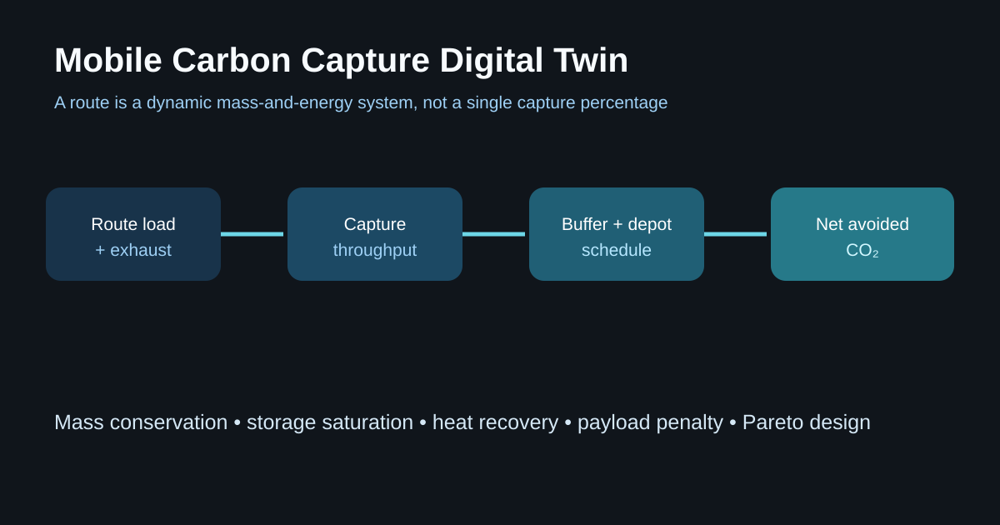

# Route-Adaptive Mobile Carbon Capture Systems Model

A transient mass-and-energy model for onboard CO₂ capture on heavy-duty routes.
It resolves the trade that static capture percentages hide: exhaust changes by
the minute, capture has a throughput limit, onboard storage fills, extra mass
and regeneration consume fuel, and depot offloading determines whether the
system can keep operating.



```bash
python -m pip install -e .
python model.py
pytest -q
```

## What the model adds

- route-level engine load and ambient conditions;
- temperature- and transient-sensitive capture efficiency;
- capture-unit throughput and buffer-storage constraints;
- heat recovery, mass penalty, and net avoided CO₂;
- depot offload scheduling and a mass-versus-avoidance Pareto frontier.

The useful innovation is joint design: the best contactor is not useful if the
buffer fills before a depot, and the highest capture rate can lose on net
emissions if its energy and payload penalties are ignored.

## Evidence base

- Al-Rowaili et al., “Onboard capture and storage system using metal-organic
  frameworks for reduced carbon dioxide emissions from vehicles,” *Cell
  Reports Physical Science* (2023): https://doi.org/10.1016/j.xcrp.2023.101467
- Pezzella et al., adsorption-based heavy-duty capture with life-cycle
  assessment, *Chemical Engineering Journal* (2025):
  https://doi.org/10.1016/j.cej.2025.161168

## Limits

This is an early design-space model, not an equipment specification. Its rate,
efficiency, fuel-penalty, and thermal equations are illustrative and are not
validated against a particular engine, sorbent, contactor, or vehicle. It omits
pressure drop, sorbent aging, detailed heat integration, safety engineering,
maintenance, and full life-cycle infrastructure. Electrification and efficiency
remain primary decarbonization pathways where feasible.
